<div align="center">

<picture>
  <source media="(prefers-color-scheme: dark)" srcset=".github/assets/banner-dark.svg">
  
</picture>

**Bring content into your app from anywhere in the operating system.**<br>
Receive validated text, URLs and files from Android shares and an iOS Share Extension through sandbox-safe handoff contracts.

[](https://packagist.org/packages/pushinbr/pam-native-share-extension)
[](https://github.com/push-in/pam-native-share-extension/releases/latest)

[](https://github.com/push-in/pam-native-share-extension/actions/workflows/ci.yml)
[](LICENSE)

[Install](#install) · [Quick example](#quick-example) · [Accepted types](#choose-the-accepted-types) · [Platforms](#platform-support) · [Docs](#docs) · [Issues](https://github.com/push-in/pam-native-share-extension/issues)

</div>

<a id="install"></a>
## <picture></picture> Install

Inside a PAM Native project, add only this capability:

```sh
pam composer require pushinbr/pam-native-share-extension
pam doctor --fix
```

New to PAM? Create a project with `pam init my-app --template native` (see the [PAM Native overview](https://push-in.github.io/pam-docs/native/overview/)), then come back here. Composer owns the manifest and the lockfile; `pam composer` runs it on PAM's verified PHP runtime.

<a id="quick-example"></a>
## <picture></picture> Quick example

```php
<?php

declare(strict_types=1);

use Pam\Native\ShareExtension\ShareInbox;

(new ShareInbox())->drain(function (array $items): void {
    foreach ($items as $item) {
        // $item->kind is a typed enum; $item->value is text, URL, or a file inbox token.
        handleSharedItem($item);
    }
});
```

Call `drain()` after launch and whenever the app resumes. Successfully returned entries are consumed, so move any file you need to retain into application-owned storage.

For file imports on both platforms, prefer `IncomingShares` (in `Pam\Native\ShareExtension` since 1.46): it returns `FileReference` values in the application sandbox and takes optional Android copy limits. Both APIs consume the same iOS App Group inbox, so use one of them per app. See [IncomingShares or ShareInbox?](docs/incoming-shares-vs-share-inbox.md) and [Android share limits](docs/android-share-limits.md). A runnable minimal app is in [`example/`](example).

<a id="platform-support"></a>
## <picture></picture> Platform support

| Platform | Support | Notes |
| --- | --- | --- |
| Android | API 26+ | `ACTION_SEND` / `ACTION_SEND_MULTIPLE` intent filters on `PamActivity` |
| iOS | 15.0+ | Generated `PamShareExtension` target (bundle suffix `.share`), App Group handoff |
| PAM Native | 1.46.0 to < 2.0.0 | From `pam-native.plugin.json`; PHP 8.5+ |

<a id="requirements"></a>
## <picture></picture> Permissions and requirements

| Platform | Declared by the plugin |
| --- | --- |
| Android | No permissions: shared content URIs are copied into the app sandbox. |
| iOS | App Group `group.<application id>.pam-native` on the app (`ios/App.entitlements`) and the extension, filled from `PAM_NATIVE_APPLICATION_ID`; framework `UniformTypeIdentifiers`. |

PAM Native generates the iOS Share Extension and Android intent filters automatically from the package manifest and the types you accept. Register the App Group for both bundle ids in your Apple developer account and include it in both provisioning profiles. Never trust shared MIME types or file contents: validate them before processing or uploading. Details: [Native integration](docs/platform-integration.md).

<a id="choose-the-accepted-types"></a>
## <picture></picture> Choose the accepted types

By default the app is offered for every share (`*/*`), several items at once. Narrow it in `pam-native.json`; prepare/build reads it (PAM Native 1.16+):

```json
{
    "plugins": {
        "shareExtension": {
            "accept": ["text/plain", "image/*", "video/*"],
            "multiple": ["image/*", "video/*"]
        }
    }
}
```

| Key | Default | Meaning |
| --- | --- | --- |
| `accept` | `["*/*"]` | 1–16 lowercase MIME types (`type/subtype` or `type/*`). |
| `multiple` | `true` | `true`: every accepted type may arrive several at once; `false`: single items only; or a list of accepted types that may. |

With the example above a PDF share no longer lists the app, a single text or link does, and photos/videos may arrive in batches. Keep validating what arrives in PHP: the share sheet is untrusted input.

<a id="api-reference"></a>
## <picture></picture> API reference

All classes live in `Pam\Native\ShareExtension`.

| API | Description |
| --- | --- |
| `(new ShareInbox())->drain(Closure(list<SharedItem>) $complete): int` | Returns and consumes every pending item (module `share-extension`). On Android it reads the share intent that launched the current activity (text, http(s) links as `Url`, up to 20 streams (1 when video is present), limited to 300 MiB each and copied off the main thread in 64 KiB chunks) and marks the intent consumed. A native failure yields an empty list. |
| `SharedItem` (readonly) | `identifier`, `kind` (`SharedItemKind`), `value` (text or URL up to 8192 bytes, or the file name/token), `mimeType`, `createdAtMillis`. |
| `SharedItemKind` (int enum) | `Text = 1`, `Url = 2`, `File = 3`. |
| `ShareExtensionPluginProvider` | Plugin provider. Accepted types are configured in `pam-native.json` under `plugins.shareExtension`. |

<a id="what-you-can-build"></a>
## <picture></picture> What you can build

- Save-to-app and read-later flows
- Import media or documents from other apps
- Create posts or messages from the system share sheet

| | |
| --- | --- |
| **Native path** | Android Sharesheet · iOS Share Extension |
| **Application model** | Composer package + generated native integration |
| **Design rule** | Independent module; no feed, vertical or application template bundled |

<a id="compatibility"></a>
## <picture></picture> Compatibility

| `pushinbr/pam-native-share-extension` | `pushinbr/pam-native` | Android | iOS |
| --- | --- | --- | --- |
| 0.4.x | `>=1.46.0 <2.0.0` | API 26+ (copy limits since 0.4.4) | 15+; owns the incoming-share capability extracted from the core. Use 0.4.3 or newer (0.4.1 failed to build, 0.4.2 withdrawn) |
| 0.3.1 | `>=1.16.0 <2.0.0` | API 26+ | 15+, accepted types from `plugins.shareExtension` |
| 0.3.0 | `>=1.16.0 <2.0.0` | — | Do not use: fails plugin discovery at runtime |
| 0.2.2 | `>=0.8.0 <2.0.0` (tested with 1.14.x) | API 26+ | 15+, files copied into the App Group with names and titles |
| 0.2.1 | `>=0.8.0 <2.0.0` | API 26+ | 15+ |

Since 1.46 the share APIs were extracted from the core into this package (requires `pushinbr/pam-native` ^1.46). The core keeps deprecated PHP aliases through 1.46; they are removed in 1.47. Native wire contracts are retained. Swift compilation and device QA remain pending.

<a id="production-rules"></a>
## <picture></picture> Production rules

- Drain after launch and every app resume.
- Move files that must survive after the successful drain.
- Validate MIME type, extension, content, and size before parsing or upload.
- Run `pam doctor`, `pam test`, and a signed release build on every supported platform.
- Exercise denial, cancellation, backgrounding, process restart, and offline behavior before release.

Security vulnerabilities should be reported through the repository security policy or GitHub private vulnerability reporting, not a public issue.

<a id="troubleshooting"></a>
## <picture></picture> Troubleshooting

- **iOS items do not arrive:** verify the shared app group on both targets.
- **Android app is absent from sharing:** inspect the generated intent filters and `plugins.shareExtension.accept`.
- **The app appears for types it should not handle:** narrow `plugins.shareExtension.accept` and rebuild.
- **A drained file disappears:** move it into application-owned storage before returning.
- **Native integration is stale:** run `pam doctor --fix`, rebuild the native host, and inspect the first reported diagnostic.

<a id="docs"></a>
## <picture></picture> Docs

- [PAM Native overview](https://push-in.github.io/pam-docs/native/overview/)
- [Plugin and native capability model](https://push-in.github.io/pam-docs/native/plugins/)
- [PAM introduction](https://push-in.github.io/pam-docs/introduction/)
- [Changelog](CHANGELOG.md)
- [Report an issue](https://github.com/push-in/pam-native-share-extension/issues)
- [Native integration (Android and iOS)](docs/platform-integration.md)
- [IncomingShares or ShareInbox?](docs/incoming-shares-vs-share-inbox.md)
- [Android share receiving with limits (0.4.4)](docs/android-share-limits.md)
- [Runnable example app](example/README.md)

<a id="pam-ecosystem"></a>
## <picture></picture> Part of the PAM ecosystem

<p align="center"><picture>
  <source media="(prefers-color-scheme: dark)" srcset=".github/assets/pam-wordmark-dark.svg">
  
</picture></p>

PAM runs PHP natively on servers, desktops and phones. This repository is one piece of it.

| [**PAM**](https://github.com/push-in/pam) | [**PAM Desktop**](https://github.com/push-in/pam-desktop) | [**PAM Native**](https://github.com/push-in/pam-native) | [**Ecosystem**](https://github.com/push-in/pam#ecosystem) |
| --- | --- | --- | --- |
| the runtime and CLI | native desktop apps in PHP | native Android and iOS apps in PHP | every official package and plugin |

<sub>Docs: [push-in.github.io/pam-docs](https://push-in.github.io/pam-docs/introduction/) · [Issues](https://github.com/push-in/pam-native-share-extension/issues)</sub>

<p align="center"><sub><a href="LICENSE">Apache License 2.0</a> · Made in Brazil by Pushin</sub></p>
